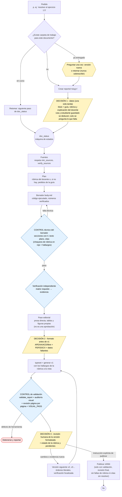

Flujo vigente de la skill `academic-report-flow` (v1 sin aprobación del borrador, 2026-11-11): tres decisiones
humanas (datos, formato antes de v1 y revisión de cada versión) y compuertas técnicas que exige una herramienta. Un
documento nuevo crea primero su carpeta de trabajo `reports/<slug>/`; luego `doc_status` deriva en qué fase está y su
`next` selecciona la referencia que se carga (ver [Skills](skills.qmd)). Los hallazgos de la rúbrica se muestran con
honestidad y no bloquean la generación de v1; generar no es declarar cumplimiento. La publicación sigue bloqueada
mientras haya fallas de rúbrica sin brecha aceptada, citas sin resolver o falte la revisión humana final.

## Fases

Cada fase produce un único artefacto en la carpeta de trabajo; `doc_status` los lee del disco y no guarda estado propio.

| Fase (`next`) | Artefacto | Quién la ejecuta |
|---|---|---|
| `intake` | `report.yml` | la skill (Decisión 1) |
| `research` | `sources.bib` | `research-workflow` |
| `plan` | `rubric.yml` | la skill |
| `draft` | `body.md` | la skill |
| `verify` | `content-check.yml` | la skill + un verificador independiente |
| `approval` | `approval.yml` (heredado, solo lectura) | fase heredada: nunca espera ni pide aprobar el borrador |
| `format` | `report.yml` | la skill (Decisión 2, antes de v1) |
| `typeset` | `body.typeset.md` | la skill |
| `generate` | PDF o DOCX bajo `outputs/<materia>/` | la skill |
| `validate` | `validation.yml` | la skill o `gentle-ai review` |
| `review` | `final-review.yml` (con `rubric-grade.md` presentada junto al PDF) | compuerta humana sobre cada versión (Decisión 3) |

Si la validación de una v1 vigente (`build/generation.yml` actual) falla por hallazgos, `doc_status` deja `validate` en
`blocked` (`validation_failed`) y marca `next: review`: el humano revisa v1 con sus hallazgos y pide una revisión
(v2/v3). `deliver` sigue en `pending` y la publicación sigue bloqueada aunque se registre una revisión final.
| `deliver` | `<slug>-vNNN.pdf` en la biblioteca de Documentos | la skill |

Las decisiones humanas se describen en [Decisiones del usuario](decisiones-usuario.qmd).

## Histórico

`docs/diagrams/` conserva diagramas anteriores (`intake-flow*`, `new-report-flow.es.*`, `report-flow.mmd`) que son
históricos y no describen el flujo actual; por eso no se publican en este portal.
