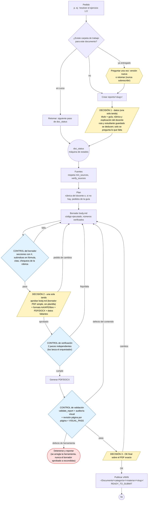

Flujo vigente de la skill `academic-report-flow` (acordado e implementado el 2026-10-01): tres decisiones humanas y,
antes de cada una, una compuerta que exige una herramienta. Un documento nuevo crea primero su carpeta de trabajo
`reports/<slug>/`; luego `doc_status` deriva en qué fase está y su `next` selecciona la referencia que se carga
(ver [Skills](skills.qmd)).

## Fases

Cada fase produce un único artefacto en la carpeta de trabajo; `doc_status` los lee del disco y no guarda estado propio.

| Fase (`next`) | Artefacto | Quién la ejecuta |
|---|---|---|
| `intake` | `report.yml` | la skill (Decisión 1) |
| `research` | `sources.bib` | `research-workflow` |
| `plan` | `rubric.yml` | la skill |
| `draft` | `body.md` | la skill |
| `verify` | `content-check.yml` | la skill + un verificador independiente |
| `approval` | `approval.yml` | compuerta humana (Decisión 2) |
| `format` | `report.yml` | la skill |
| `typeset` | `body.typeset.md` | la skill |
| `generate` | PDF o DOCX bajo `outputs/<materia>/` | la skill |
| `validate` | `validation.yml` | la skill o `gentle-ai review` |
| `review` | `final-review.yml` | compuerta humana (Decisión 3) |
| `deliver` | `<slug>-vNNN.pdf` en la biblioteca de Documentos | la skill |

Las decisiones humanas se describen en [Decisiones del usuario](decisiones-usuario.qmd).

## Histórico

`docs/diagrams/` conserva diagramas anteriores (`intake-flow*`, `new-report-flow.es.*`, `report-flow.mmd`) que son
históricos y no describen el flujo actual; por eso no se publican en este portal.
