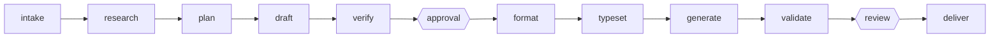

Documento de propuesta para `skills/academic-report-flow`. No modifica la skill ni las herramientas: describe qué cambiar, dónde y a qué costo. Las prioridades salen de la respuesta del usuario: **la rúbrica más presente en cada punto y, sobre todo, una calificación final contra ella**; además "Muy lenta / demasiadas fases", "Calidad del texto" y "No sigue la rúbrica/guía".

Las referencias `ruta:línea` corresponden al estado actual de la rama `feat/quarto-docs-portal`.

## 1. Diagnóstico breve

### Cómo funciona hoy

El flujo tiene **12 fases** (`tools/doc_status.py:55-72`) y **3 decisiones humanas** (`skills/academic-report-flow/SKILL.md:22`): datos, aprobación del borrador más formato, y revisión final. La ruta académica no admite el modo `express` (`tools/doc_status.py:181-186`), de modo que recorre todas las fases.

Hexágonos: decisiones humanas. Además de ellas hay paradas de herramienta: verificador independiente obligatorio (`references/production.md:9-11`), vista previa en PDF antes de aprobar (`references/approval.md:25`) e inspección página por página en `validate` (`references/production.md:62,66`).

### Dónde se usa la rúbrica y dónde no

| Fase | ¿Usa la rúbrica? | Evidencia |
|---|---|---|
| intake | Solo la pide (`guide:`) | `references/data.md:12` |
| plan | Sí: crea `rubric.yml` y los `checks:` | `references/content.md:14-23` |
| draft | Sí, pero solo al final: el chequeo corre sobre el borrador completo | `references/content.md:41` |
| verify | Sí: matriz requisito → evidencia, por criterio `cumple`/`falta` | `references/production.md:5-17`, `tools/content_check.py:511` |
| approval | Parcial: el paquete lista criterios con conteo `found/total`, sin peso ni nota | `tools/approval_packet.py:68-92` |
| format, typeset | No | `references/production.md:19-28` |
| generate, validate | **No**: ni `validate_report.py`, ni `build_report_auto.py`, ni `deliver_report.py` mencionan la rúbrica | búsqueda de `rubric` en esos tres archivos: sin resultados |
| review | **No**: el marcador solo liga el hash del PDF | `references/delivery.md:7`, `tools/doc_status.py:646-670` |
| deliver | No | `references/delivery.md:13-29` |

Hallazgos que fundamentan las propuestas:

- El `weight` de cada criterio se valida (`tools/rubric_plan.py:146-152`) pero su único uso es repartir el presupuesto de palabras (`tools/concision.py:169-186`). Nunca se convierte en puntaje.
- La verificación es deliberadamente binaria: el verificador "no puntúa" (`references/production.md:10`; `tools/content_check.py:5`). Fue decisión del usuario sustituir los jueces por un verify (`odd/tasks/verify-concise-drafts.md`, S1) tras la primera autocalificación del redactor (`odd/tasks/report-flow-hardening.md`). Existió un estado `flojo`, hoy solo legado (`tools/content_check.py:76`).
- La evidencia de la matriz se cita de `body.md`, no del PDF final: tras `typeset` y `generate` nadie vuelve a comprobar la rúbrica sobre lo que se entrega.
- Ya se probó acortar el flujo solo en rutas B-E (`odd/tasks/report-flow-render-express.md`, T7). El camino académico sigue completo.

## 2. Propuestas

### (a) Rúbrica presente en cada punto y calificación final

**Problema.** La rúbrica interviene en `plan`, `draft`, `verify` y `approval`, y desaparece desde `typeset` hasta `deliver` (tabla anterior). No existe ninguna salida que diga "con esta rúbrica el documento obtendría X". El usuario aprueba y revisa el PDF sin ver cuánto cubre cada criterio.

**Cambio propuesto.**

1. **Traza de rúbrica por sección** (`tools/rubric_trace.py`, solo lectura). Reutiliza `rubric_plan.load_rubric` y `rubric_checks.run_checks` y emite por criterio: `id`, peso, sección mapeada, checks verdes/rojos, requisitos `found/total` (si hay `content-check.yml` vigente) y palabras usadas frente a su presupuesto. Se invoca en:
   - `plan`: tablero TDD con todo en rojo, antes de redactar.
   - `draft`: tras cada sección (no solo al final, `references/content.md:41`); `section_scope_warnings` (`tools/rubric_checks.py:139`) ya detecta secciones ausentes.
   - `approval`: se añade peso y puntaje estimado al paquete (`tools/approval_packet.py:68-92`).
   - `typeset` y `validate`: se vuelven a correr los checks sobre `body.typeset.md` y sobre el texto extraído del PDF final (hoy `validate_report.py` no los ve).
2. **Tabla final calificada** (`tools/rubric_grade.py`, escribe `rubric-grade.yml` y `rubric-grade.md` en la carpeta de trabajo). Columnas:

   | Criterio | Peso | Ubicación de la evidencia | Puntaje estimado | Brecha |
   |---|---|---|---|---|
   | id + título | `weight` | sección y página del PDF donde está la cita | `weight × found/total`, 0 si falla un check determinista | requisitos `missing` y párrafos sin mapear |

   El puntaje lo calcula la herramienta a partir de la matriz; el verificador sigue sin puntuar, así que se respeta la decisión de `verify-concise-drafts`. La página sale de buscar la cita de evidencia en el texto del PDF. La tabla se rotula "estimación mecánica, no la nota del docente".
3. **Dónde se exige.** `validate` genera la tabla sobre el PDF exacto; `doc_status` agrega a la guía de `review` (`tools/doc_status.py:127`) presentar la tabla junto al PDF; `references/delivery.md:7` y `SKILL.md:59-61` (contrato de salida) la incluyen. Opcional: `final-review.yml` registra `rubric_grade_sha256`.
4. **Sin peso en la rúbrica**, la herramienta reparte pesos iguales y lo señala; un peso ausente nunca se inventa.

**Costo/riesgo.** Dos herramientas nuevas, cambios en `doc_status`, `approval_packet` y tres referencias; pruebas nuevas. Riesgo principal: que la estimación se lea como nota real. Segundo: mapear cita → página falla si el texto se parte entre páginas (degradar a "sección" sin página). El marcador de `review` no cambia de forma obligatoria, así que los reportes ya entregados no se invalidan.

**Cómo verificarlo.** Pruebas unitarias con `tools/fixtures` y una rúbrica de pesos 40/30/30 (puntaje esperado calculado a mano); prueba de que un check rojo pone el criterio en 0; prueba de que `rubric_grade.py` no escribe fuera de la carpeta de trabajo; ejecución sobre un reporte real ya entregado y comparación de la tabla con la nota que dio el docente.

### (b) Menos fases y camino más rápido

**Problema.** 12 fases, 3 paradas humanas y varias pasadas por agente (verificador, `typeset` manual, inspección visual) para un documento que el usuario describe como "muy lento". Hoy no hay medición: no se sabe qué fase consume el tiempo.

**Cambio propuesto** (de menor a mayor impacto):

1. **Medir primero.** Un recibo `timings.yml` derivado de las marcas de tiempo de los artefactos (`doc_status` ya los lee) para ver tiempo por fase en los próximos 3-4 reportes.
2. **Paralelizar `verify` con la vista previa.** El verificador solo necesita `body.md` y la rúbrica; la compilación de la vista previa (`references/approval.md:25`) no depende de él. Cambio solo en la skill.
3. **Automatizar `typeset`.** Hoy el agente edita `body.typeset.md` a mano (`references/production.md:23-26`). Un modo `typeset.py auto` convertiría de forma determinista tablas desde líneas `a; b`, líneas `Figura: ...`, URL desnudas y fórmulas simples, y dejaría al agente solo los casos ambiguos. **Hecho** (`tools/typeset_auto.py`): `typeset.py auto` convierte tablas, figuras y URL; deja la cabecera de cada tabla vacía (el borrador no trae nombres de columna) y `typeset.py check` la exige con `table_headers`; las fórmulas solo se señalan.
4. **Fases visibles agrupadas** (conservando artefactos y recibos):
   - `format` desaparece como fase propia: ya "normalmente queda `done` sin parada" (`references/approval.md:41`).
   - `typeset + generate + validate` se presentan como una sola fase `build` con un único comando que encadena las tres.
   - `deliver` se ejecuta automáticamente tras el OK de `review`.

   Resultado: 12 → 8 fases visibles (intake, research, plan, draft+verify, approval, build, review, deliver) sin quitar ninguna decisión humana.
5. **Vista previa opcional.** El aprobador debe leer `body.md` completo (`references/approval.md:21`); el PDF previo de un texto plano aporta poco. Hacerlo opt-in recorta una compilación completa.
6. **Inspección visual escalonada.** Si el auditor da PASS y el documento usa plantilla estable, inspeccionar solo las páginas con figuras o tablas (`references/production.md:62,66`).

**Costo/riesgo.** Los puntos 1-3 y 5 son de bajo riesgo. El punto 4 toca el contrato "un artefacto por fase" que valida la suite (`odd/tasks/draft-phase-before-approval.md`, diseño) y las pruebas `test_doc_status_*`; conviene agrupar en la presentación y no eliminar fases en `PHASES`. El punto 6 debilita un control que existe por defectos reales (`odd/tasks/plain-text-draft.md`), por lo que requiere decisión del usuario.

**Cómo verificarlo.** Comparar `timings.yml` antes y después en un reporte equivalente; la suite completa (`tools/` y `tests/`) en verde; prueba de que el orden de `Route:` en `doc_status` no cambia; revisar que ningún `approval.yml` ni `final-review.yml` se crea sin respuesta explícita.

### (c) Calidad del texto

**Problema.** El estilo se pide en prosa (`references/content.md:31-38`: "humano y natural", "modela el tono del usuario") pero casi nada es verificable: el único control mecánico son frases de relleno y párrafos de más de 80 palabras como advertencia (`tools/concision.py:17,20`; `references/content.md:41`). La revisión de repeticiones, circularidad y ambigüedad ocupa una frase del verificador (`references/production.md:17`). La regla de no abrir conclusiones con "Se concluye" vive como ítem de inspección visual (`references/production.md:75`), no como check.

**Cambio propuesto.**

1. **Más lint determinista en `concision.py`** (advertencias, no bloqueos): oraciones de más de ~35 palabras, repetición de n-gramas entre párrafos y secciones, apertura repetida de párrafos, y los inicios formulaicos de conclusión como FAIL en la sección de conclusiones.
2. **Esquema de hallazgos de prosa** en el YAML del verificador: `prose_findings: [{location, kind: repeticion|circular|ambiguo|relleno|registro, quote, fix}]`, con tope de entradas; `content_check.py` valida que la cita exista, igual que con los requisitos.
3. **Muestra de estilo del usuario** (`style-sample.md` en el perfil del curso o en la carpeta de trabajo) con 2-3 párrafos aprobados antes; el borrador y el verificador la reciben como referencia en lugar de "imitar al usuario" sin material.
4. **Redacción por secciones** con chequeo tras cada una (comparte mecanismo con (a).1).

**Costo/riesgo.** El lint produce falsos positivos en textos técnicos con terminología repetida; por eso solo advierte y solo bloquea los patrones inequívocos. La muestra de estilo es dato personal del usuario: queda en la carpeta de trabajo, nunca en la entrega.

**Cómo verificarlo.** Un conjunto de borradores reales pasados (buenos y malos, ya aprobados o corregidos por el usuario) como fixtures: medir falsos positivos y confirmar que los borradores corregidos manualmente tenían hallazgos. Pruebas unitarias por cada patrón nuevo.

### (d) Brechas con la guía y la rúbrica

**Problema.**

- Un criterio puramente semántico "puede no tener checks" (`references/content.md:20`); entonces solo lo sostiene una cita del verificador, que prueba presencia, no suficiencia: `found` se degrada solo si la cita no está en `body.md` (`tools/content_check.py:489-503`).
- No hay estado intermedio: la derivación es solo `cumple`/`falta` (`tools/content_check.py:511`), así que un criterio cubierto a medias se ve igual que uno ausente.
- Las exigencias de la guía llegan a la rúbrica por lectura del agente; `guide_facts.py` solo reporta hechos explícitos (`references/data.md:12`). Una exigencia que el agente no vio no tiene criterio ni check.
- Sin rúbrica del docente, los criterios salen de las demandas explícitas de la guía (`references/content.md:18`), pero nada compara esa lista con la guía.

**Cambio propuesto.**

1. **Inventario de exigencias de la guía** (extensión de `guide_facts.py`): lista numerada de verbos de mandato, preguntas y entregables detectados. `rubric_plan.py` exige que cada ítem del inventario figure en `deliverables:` de algún criterio o en una lista `not_applicable:` justificada.
2. **Estado `partial`** en la matriz (`found|partial|missing`), con la brecha escrita; entra en la columna "Brecha" de (a) y cuenta como 0,5 del requisito. Sigue siendo evidencia, no calificación: el verificador no asigna nota.
3. **Checks sobre el artefacto final**: repetir `run_checks` contra el texto del PDF en `validate` (ver (a).1), para detectar pérdidas introducidas por `typeset`.
4. **Regla de bloqueo**: no se ofrece `approval` mientras exista un requisito `missing` o una exigencia del inventario sin criterio, salvo omisión registrada por el usuario.

**Costo/riesgo.** El inventario es heurístico: sobredetecta (se mitiga con `not_applicable:`) y subdetecta (no sustituye la lectura humana). `partial` cambia el esquema de `content-check.yml` y su validación en `content_check.py`; hay que mantener compatibilidad con marcadores existentes. Bloquear la aprobación puede frustrar si la guía es ambigua.

**Cómo verificarlo.** Tomar dos guías reales (una APE y una AA), listar a mano sus exigencias y medir qué parte detecta el inventario; prueba de que un criterio con exigencia sin mapear bloquea `rubric_plan`; pruebas de compatibilidad con un `content-check.yml` previo sin `partial`.

### (e) Borrador simple, sin plantilla institucional

**Problema.** La vista previa para la aprobación se construye con `build_report_auto.py <folder> --no-approval-check` (`references/approval.md:25`). Ese comando recorre el mismo camino que la entrega final: carga `report.yml`, usa el backend y la plantilla del tipo de informe (por ejemplo AA, con portada y logos) y corre todos los validadores (`tools/build_report_auto.py:154-190`). El usuario aprueba contenido, no maquetación, así que compilar la plantilla completa en cada ronda de edición es tiempo perdido y además muestra hallazgos de formato (`PREVIEW FINDINGS`) que todavía no corresponden.

**Cambio propuesto.**

1. Un modo `--draft` (o una herramienta `draft_pdf.py`) que convierta `body.md` a un PDF simple: sin portada, sin logos, sin plantilla del curso, solo títulos, párrafos, tablas, figuras y referencias. Puede reutilizar `templates/plain-report.tex` o el camino HTML de `build_report.py`.
2. El PDF se escribe en un directorio temporal (fuera de la carpeta del informe y de la entrega) y se abre en el visor, como hoy hace `approval_packet.py --open`.
3. Se mantiene el registro del sha256 de `body.md` que consume `doc_status`, para que la puerta de aprobación siga detectando una vista previa vieja.
4. La plantilla institucional se compila una sola vez, en la construcción final después de `typeset`.

**Costo/riesgo.** Hay que mover el registro del hash a la ruta temporal y ajustar `approval_packet.py` y `doc_status.py`. El borrador no muestra problemas de maquetación, pero esos ya se auditan después de `typeset` (`references/production.md`).

**Cómo verificarlo.** Medir el tiempo de una ronda de vista previa antes y después con un informe AA real; prueba de que el PDF de borrador no contiene la portada ni se escribe en la carpeta de entrega; prueba de que `doc_status` sigue marcando como vieja una vista previa cuyo hash no coincide.

## 3. Orden sugerido de implementación

Cada rebanada es un commit revisable, con pruebas y documentación juntas.

| # | Rebanada | Toca | Depende de |
|---|---|---|---|
| 1 | `rubric_trace.py` de solo lectura y peso/puntaje en el paquete de aprobación | `tools/`, `approval_packet.py` | nada |
| 2 | `rubric_grade.py` con tabla final y búsqueda de página en el PDF | `tools/`, pruebas | 1 |
| 3 | Presentar la tabla en `review` (guía de `doc_status`, `delivery.md`, `SKILL.md`) | skill, `doc_status.py` | 2 |
| 4 | Checks de rúbrica sobre `body.typeset.md` y el PDF en `validate` | `validate_report.py`, `production.md` | 1 |
| 5 | `timings.yml` y paralelizar `verify` con la vista previa | `doc_status.py`, `approval.md` | nada |
| 6 | Lint adicional en `concision.py` y `prose_findings` | `concision.py`, `content_check.py` | nada |
| 7 | Inventario de exigencias de la guía y estado `partial` | `guide_facts.py`, `rubric_plan.py`, `content_check.py` | 2 |
| 8 | `typeset.py auto` y agrupación visible de fases (`build`) | `typeset.py`, `doc_status.py` | 5 (datos de tiempo) |
| 9 | Borrador simple en PDF temporal, sin plantilla (e) | `build_report_auto.py` o `draft_pdf.py`, `approval_packet.py`, `doc_status.py` | nada |

Las rebanadas 1-4 cubren la prioridad principal; 5-8 pueden reordenarse según lo que muestre la medición.

## 4. Preguntas abiertas para el usuario

1. **Puntaje y la decisión previa.** Antes se eligió que el verificador "no puntúa" (`verify-concise-drafts`, S1). ¿Se acepta que la herramienta calcule un puntaje estimado a partir de la matriz, con el verificador sin puntuar? **Respuesta (2026-11-05): sí.**
2. **Pesos.** ¿La rúbrica de los docentes trae puntajes por criterio? Si no, ¿se prefieren pesos iguales o preguntarlos en `plan`?
3. **Escala y redondeo.** ¿Sobre 10, sobre el total de la rúbrica o en porcentaje?
4. **Estado `partial`.** ¿Contarlo como 0,5, o mostrarlo como brecha sin puntuar?
5. **Fases.** ¿Está bien agrupar `typeset + generate + validate` como una sola fase visible, aun si la suite pide ajustar el contrato de un artefacto por fase?
6. **Vista previa y revisión visual.** ¿Puede ser opcional la vista previa en PDF antes de aprobar, y escalonada la inspección página por página?
7. **Dónde vive la tabla.** La carpeta de entrega admite solo el PDF y su `.bib` (`references/delivery.md:28`). ¿La tabla se queda en la carpeta de trabajo, o se quiere una copia fuera de la entrega?
8. **Muestra de estilo.** ¿Hay textos del usuario ya aprobados que sirvan como referencia de tono?
